<a href="https://portfolio-simon-pierre.vercel.app"></a>

<p align="center">
  <a href="https://portfolio-simon-pierre.vercel.app"></a>&nbsp;
  <a href="https://www.linkedin.com/in/simon-pierre"></a>&nbsp;
  
</p>

## 👨‍💻 À propos

```ts
const simon = {
  role: 'Développeur Back-End Node.js / NestJS · Full Stack & Data',
  location: 'Nantes, France',
  education: 'Bac+5 Expert en Informatique et SI (RNCP 7), EPSI Nantes',
  experience: "3 ans d'alternance chez Altior, éditeur d'ERP industriel",
  backend: ['NestJS', 'GraphQL', 'API REST', 'PostgreSQL', 'Prisma', 'Redis'],
  frontend: ['React', 'Next.js', 'TanStack Query', 'Tailwind CSS', 'shadcn/ui'],
  ai: ['API Claude (Anthropic SDK)', 'Claude Code', 'ChatGPT'],
  lookingFor: 'CDI back-end / full stack, disponible immédiatement',
};
```

## 💼 Expérience

### Altior · Développeur Full Stack en alternance
<sub><b>07/2023 – 09/2026 · 3 ans</b> · éditeur de logiciel ERP pour l'industrie · Nantes</sub>

<table>
  <tr>
    <td width="50%" valign="top">
      <h4>🛠️ Altior Tools</h4>
      <p>Administration et reprise des données ERP. <b>L'un des 3 principaux contributeurs</b> : <b>1 000+ commits</b>, ~200 tickets livrés, 100+ modules métier, du schéma d'API jusqu'à l'écran.</p>
      <ul>
        <li>Reprise de données clients automatisée (ETL) : <b>−50 % de temps</b></li>
        <li>Provisionnement des plateformes clients : <b>~2 min au lieu d'1 h</b></li>
      </ul>
      
      
      
      
    </td>
    <td width="50%" valign="top">
      <h4>📊 Jira Analysis</h4>
      <p>Pilotage produit et analyse de données. <b>6 sources agrégées</b> (Jira, Tempo, Confluence, Zendesk, PayFit, Pennylane) dans une base synchronisée.</p>
      <ul>
        <li>Dashboard des dépenses par catégorie analytique</li>
        <li>Enrichissement en masse des tiers (SIREN / TVA)</li>
      </ul>
      
      
      
    </td>
  </tr>
  <tr>
    <td width="50%" valign="top">
      <h4>🌐 Internal Hub <sub><i>conçu en autonomie</i></sub></h4>
      <p>Vue client 360° : fiche unifiée agrégeant <b>8 sources</b> (HubSpot, Zendesk, Jira, Pappers, API ERP, S3…) et <b>20 widgets</b> en drag &amp; drop.</p>
      
      
      
      
    </td>
    <td width="50%" valign="top">
      <h4>📈 Sales Service <sub><i>conçu en autonomie</i></sub></h4>
      <p>Forecast commercial sans export Excel, alimenté par des snapshots HubSpot quotidiens : deals pondérés, signatures du mois, simulation.</p>
      
      
      
    </td>
  </tr>
</table>

<sub>Avant : 2 stages de développeur web (2022, 2023) chez GoodFloow et La Tête dans la Toile, à Nantes.</sub>

## 🚀 Projets perso

<table>
  <tr>
    <td colspan="2" valign="top">
      <h4>🏢 SaaS B2B <sub><i>en cours</i></sub></h4>
      <p>Gestion de patrimoine technique multi-sites : équipements, contrôles périodiques, maintenance, documents et tableaux de bord. Développé seul : <b>91 modules métier</b>, <b>437 modèles de données</b>.</p>
      
      
      
      
      
      
      
      
      
      
      
      
      
      
      
      
      
      
      
      
      
      
      
      
      
      
      
      
      
      
      
    </td>
  </tr>
  <tr>
    <td width="50%" valign="top">
      <h4>🤖 Bot Discord + panel d'administration</h4>
      <p>Modération, <b>anti-raid</b>, musique, niveaux et logs, pilotés depuis un <b>panel web</b> avec connexion Discord et droits par rôle.</p>
      
      
      
      
      
      
    </td>
    <td width="50%" valign="top">
      <h4>💰 InvestTrack</h4>
      <p>Suivi d'investissements avec un conseiller IA.</p>
      
      
      
      <br/>
      <h4>📸 App de car spotting</h4>
      <p>App mobile : on photographie une voiture, l'IA lit la plaque et l'ajoute à sa collection.</p>
      
      
      
      
    </td>
  </tr>
</table>

## 🛠️ Stack

<table align="center">
  <tr>
    <td align="right"><b>Back-end</b></td>
    <td></td>
  </tr>
  <tr>
    <td align="right"><b>Front-end</b></td>
    <td></td>
  </tr>
  <tr>
    <td align="right"><b>Données</b></td>
    <td></td>
  </tr>
  <tr>
    <td align="right"><b>DevOps &amp; outils</b></td>
    <td></td>
  </tr>
  <tr>
    <td align="right"><b>Tests</b></td>
    <td></td>
  </tr>
</table>

## 📈 Activité

<div align="center">

<picture>
  <source media="(prefers-color-scheme: dark)" srcset="https://raw.githubusercontent.com/Docky44/Docky44/output/github-contribution-grid-snake-dark.svg"/>
  <source media="(prefers-color-scheme: light)" srcset="https://raw.githubusercontent.com/Docky44/Docky44/output/github-contribution-grid-snake.svg"/>
  
</picture>


</div>

<div align="center">
  
</div>
